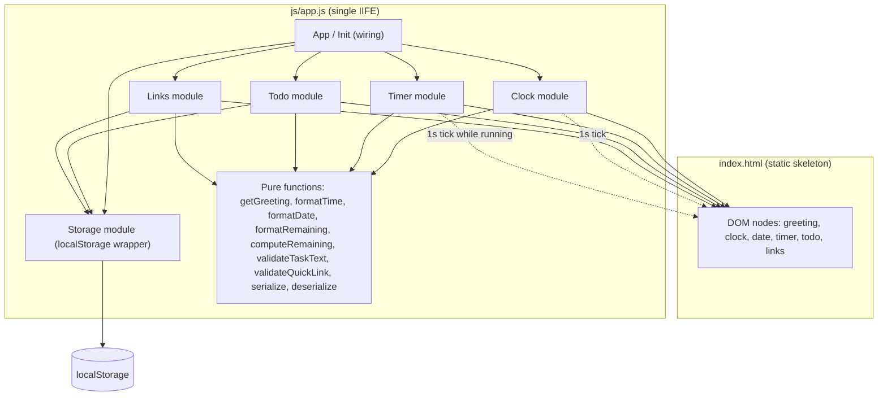
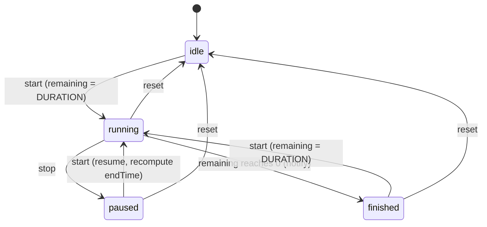
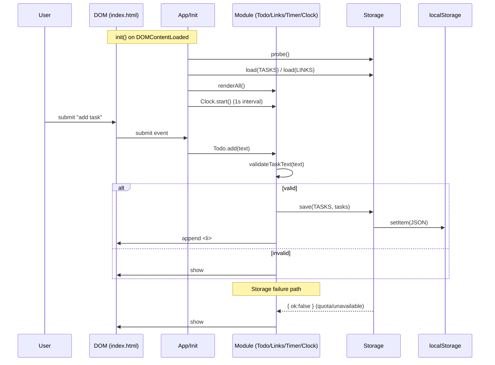

# Design Document: To-Do List Life Dashboard

## Overview

This document defines the technical design for the **Life Dashboard**, a client-side personal productivity web application. The dashboard combines four co-located features — a live time/date greeting, a 25-minute focus timer, a to-do list, and quick links — all persisted in the browser via the Local Storage API. The application has no backend server.

The design is driven by hard structural constraints from Requirement 9 that shape every other decision:

- Exactly **one** CSS file (`css/style.css`) and **one** JavaScript file (`js/app.js`). No build step, no bundler, no transpiler, no module loader.
- Vanilla JavaScript using only browser-native APIs. No external libraries or frameworks at runtime.
- No inline `style` attributes, no inline `<script>` blocks, and no inline event-handler attributes (e.g. no `onclick=`) in any HTML file. All behavior is attached via `addEventListener`.
- The application must run when its HTML file is opened directly via the `file://` protocol (Requirement 8.2).

The last constraint is decisive: ES module syntax (`type="module"`, `import`/`export`) is blocked by CORS when a page is loaded over `file://`. Therefore the single JavaScript file is written as a classic script wrapped in one Immediately Invoked Function Expression (IIFE). Logical modules are organized as plain objects/closures inside that IIFE, so no globals leak to `window` and the code works identically from `file://`, a static server, and a browser-extension popup.

The design separates **pure logic** (greeting determination, time/date formatting, timer remaining computation, input validation, serialization) from **side-effecting code** (DOM updates, intervals, Local Storage I/O). The pure functions are the seam that makes the feature unit-testable and property-testable without a DOM, and they are deliberately exposed in a minimal, read-only namespace for the test harness.

### Goals and Non-Goals

**Goals**
- Deliver a single-file vanilla-JS architecture that satisfies every requirement, including the round-trip persistence property, non-disruptive clock updates, and cross-browser compatibility.
- Make the core business logic (greeting, validation, timer math, serialization) independently testable as pure functions.

**Non-Goals**
- No server, no sync, no multi-user, no cloud storage.
- No test framework is required to *run* the dashboard (Requirement 9.4). A test harness is described in the Testing Strategy as an optional developer-time artifact only; it is not part of the shipped application files.
- No persistence of the focus timer state across sessions (only Tasks and Quick Links are persisted, per Requirement 5).

---

## Architecture

### High-Level Architecture

The application is a single HTML page with three logical layers, all contained in one JS file:

1. **Presentation layer (DOM)** — the static HTML skeleton plus targeted, surgical DOM mutations. The DOM is treated as an output surface, never as a source of truth. The skeleton is rendered once; thereafter each module patches only the nodes it owns.
2. **Logic layer (pure functions)** — side-effect-free functions for greeting, time/date formatting, timer remaining computation, input validation, and serialization/deserialization. These have no DOM or storage dependencies and are the testable core.
3. **Persistence layer (Storage module)** — a thin wrapper around `localStorage` with one-time availability detection and quota-error handling.

A fourth concern, **scheduling**, is owned by two independent intervals: the clock interval (updates greeting/time/date every second) and the timer interval (counts down the focus timer). They are deliberately decoupled so that the clock keeps running while the timer is paused or finished (Requirement 2.6), and so that clock ticks never re-render lists or touch input fields (Requirement 6.4).

### Architectural Diagram



### Key Architectural Decisions

| Decision | Rationale |
|---|---|
| Classic script + IIFE (no ES modules) | ES modules fail over `file://` (CORS). The app must run when opened directly (Req 8.2). An IIFE keeps the single-file constraint while avoiding global leakage. |
| Pure-logic / side-effect split | Lets the testable core (greeting, validation, timer math, serialization) be unit- and property-tested without a DOM or storage. |
| Targeted DOM updates, not full re-render per tick | Requirement 6.4 demands that the 1-second clock update never disrupts an active input's focus, cursor, or text. Re-rendering lists on every tick would violate this, so the clock patches only its own three text nodes. |
| Timestamp-based timer, not counter decrement | A naive "subtract one each tick" drifts. The timer records `endTime` and computes `remaining = endTime - now` each tick. This is drift-free and keeps the greeting interval independent (Req 2.6). |
| One-time storage availability probe | Browsers signal "storage full" only by throwing on `setItem`. Detecting support once at startup (set/remove a dummy key) lets later throws be interpreted purely as quota errors (Req 5.5/5.6). |
| Identical code for standalone and extension | The extension reuses `index.html` as a Manifest V3 popup. `window.open(url, '_blank')` opens a new tab from a popup, so no extension-specific branching is needed (Req 8.3). |
| Expose pure functions on a read-only test namespace | Single-file, non-module code cannot be imported. A minimal `window.LifeDashboardPure` object exposes only side-effect-free functions so the test harness can reach them without polluting production behavior. |

---

## Components and Interfaces

All components live inside one IIFE in `js/app.js`. Each is a plain object (or small set of closures) with explicit responsibilities. Function signatures below use TypeScript-style annotations for clarity; the implementation is plain JavaScript.

### DOM Structure (index.html)

The HTML is a static skeleton. No element carries inline styles or inline handlers. IDs are the attachment points for `addEventListener`.

```html
<!DOCTYPE html>
<html lang="en">
<head>
  <meta charset="UTF-8" />
  <meta name="viewport" content="width=device-width, initial-scale=1.0" />
  <title>Life Dashboard</title>
  <link rel="stylesheet" href="css/style.css" />
</head>
<body>
  <main class="dashboard">
    <!-- 1. Greeting / Clock -->
    <section class="section greeting-section" aria-label="Greeting and clock">
      <h1 class="greeting" id="greeting">Good morning</h1>
      <p class="clock" id="clock">--:--:--</p>
      <p class="date" id="date"></p>
    </section>

    <!-- 2. Focus Timer -->
    <section class="section timer-section" aria-label="Focus timer">
      <h2 class="section-heading">Focus Timer</h2>
      <p class="timer-display" id="timer-display">25:00</p>
      <div class="timer-controls">
        <button type="button" class="btn" id="timer-start">Start</button>
        <button type="button" class="btn" id="timer-stop">Stop</button>
        <button type="button" class="btn" id="timer-reset">Reset</button>
      </div>
      <p class="timer-notification" id="timer-notification" role="status" aria-live="polite"></p>
    </section>

    <!-- 3. To-Do List -->
    <section class="section todo-section" aria-label="To-do list">
      <h2 class="section-heading">To-Do List</h2>
      <form class="todo-form" id="todo-form">
        <input type="text" id="todo-input" class="todo-input"
               maxlength="255" placeholder="Add a task…" aria-label="New task" />
        <button type="submit" class="btn">Add</button>
      </form>
      <p class="todo-error" id="todo-error" role="alert"></p>
      <ul class="todo-list" id="todo-list"></ul>
    </section>

    <!-- 4. Quick Links -->
    <section class="section links-section" aria-label="Quick links">
      <h2 class="section-heading">Quick Links</h2>
      <form class="links-form" id="links-form">
        <input type="text" id="link-name" class="link-input"
               maxlength="50" placeholder="Name" aria-label="Link name" />
        <input type="url" id="link-url" class="link-input"
               maxlength="2048" placeholder="https://example.com" aria-label="Link URL" />
        <button type="submit" class="btn">Add</button>
      </form>
      <p class="links-error" id="links-error" role="alert"></p>
      <div class="links-list" id="links-list"></div>
    </section>

    <!-- Global persistence error banner -->
    <p class="storage-error" id="storage-error" role="alert" hidden></p>
  </main>
  <script src="js/app.js"></script>
</body>
</html>
```

To-do list items and quick-link buttons are generated dynamically by their modules. A rendered task `<li>` looks like:

```html
<li class="todo-item" data-id="<id>">
  <input type="checkbox" class="todo-checkbox" />
  <span class="todo-text">Task description</span>
  <!-- When editing, the span is swapped in place for: -->
  <input type="text" class="todo-edit" maxlength="255" />
  <button type="button" class="btn btn-edit">Edit</button>
  <button type="button" class="btn btn-delete">Delete</button>
</li>
```

A rendered quick-link button looks like:

```html
<div class="link-item" data-id="<id>">
  <button type="button" class="link-button">Name</button>
  <button type="button" class="btn btn-delete-link">Delete</button>
</div>
```

### CSS Organization (css/style.css)

One file, organized by numbered comment sections mirroring the components. No inline styles anywhere.

```css
/* ===== 1. Design tokens (CSS custom properties) ===== */
:root { --font-stack: system-ui, -apple-system, 'Segoe UI', Roboto, sans-serif;
        --text-color: #1a1a1a; --bg-color: #ffffff; --gap: 1.5rem; ... }

/* ===== 2. Base / reset ===== */
/* ===== 3. Layout (.dashboard, .section, dividers) ===== */
/* ===== 4. Greeting section ===== */
/* ===== 5. Timer section ===== */
/* ===== 6. To-do list ===== */
/* ===== 7. Quick links ===== */
/* ===== 8. Buttons & inputs ===== */
/* ===== 9. Error / notification states ===== */
/* ===== 10. Extension popup sizing (min-width/height on body) ===== */
```

Design tokens centralize the sans-serif font family (Req 7.4), the ≥16px base font size (Req 7.2), and the ≥4.5:1 text/background contrast pair (Req 7.5). Section dividers/spacing implement uniform spacing (Req 7.3) and visual separation (Req 7.1). The extension-popup section sets a minimum body size so the reused HTML renders well inside a toolbar popup.

### Component: Clock Module

Owns greeting, current time, and current date. Runs an independent 1-second interval.

| Member | Signature | Description |
|---|---|---|
| `getGreeting` | `(date: Date) => string` | Pure. Returns `"Good morning"`, `"Good afternoon"`, or `"Good evening"` per the time-of-day bands. |
| `formatTime` | `(date: Date) => string` | Pure. Returns `"HH:MM:SS"` (24-hour, zero-padded). |
| `formatDate` | `(date: Date) => string` | Pure. Returns a localized long date, e.g. `"Monday, January 1, 2024"`. |
| `start` | `() => void` | Starts the 1s interval. The callback updates **only** `#greeting`, `#clock`, `#date` via `textContent`. It never queries, re-renders, or replaces list nodes or inputs. |
| `stop` | `() => void` | Clears the interval. |

**Greeting bands (Requirement 1.3–1.5):**
- `00:00 ≤ t < 12:00` → `"Good morning"`
- `12:00 ≤ t < 18:00` → `"Good afternoon"`
- `18:00 ≤ t < 24:00` → `"Good evening"`

```js
function getGreeting(date) {
  const h = date.getHours();
  if (h < 12) return "Good morning";
  if (h < 18) return "Good afternoon";
  return "Good evening";
}
```

**Non-disruptive update (Requirement 6.4):** the tick callback is restricted to its own three elements. Because it uses `textContent` assignment (not `innerHTML` and not parent re-render), and never touches `#todo-list`, `#links-list`, or any input, focus/cursor/text in an active field cannot be lost.

### Component: Timer Module

Owns the 25-minute focus countdown. State machine with four states.



| Member | Signature | Description |
|---|---|---|
| `DURATION_MS` | `1500000` | 25 minutes in ms. |
| `state` | `'idle' \| 'running' \| 'paused' \| 'finished'` | Current state. |
| `remainingMs` | `number` | Remaining time while paused/finished. |
| `endTime` | `number \| null` | Wall-clock deadline while running. |
| `formatRemaining` | `(ms: number) => string` | Pure. `"mm:ss"`, zero-padded, clamps negative to 0. |
| `computeRemaining` | `(endTimeMs: number, nowMs: number) => number` | Pure. `Math.max(0, endTimeMs - nowMs)`. |
| `start` | `() => void` | If `idle`/`finished`, set `remaining = DURATION` then run. If `paused`, resume. Sets `endTime = now + remaining`, transitions to `running`, starts a 1s interval calling `tick`. |
| `stop` | `() => void` | Only from `running`: captures `remainingMs = computeRemaining(endTime, now)`, clears interval, transitions to `paused`. |
| `reset` | `() => void` | From any state: clears interval, `remainingMs = DURATION_MS`, `endTime = null`, `state = 'idle'`, display = `"25:00"`, clears notification. |
| `tick` | `() => void` | `remaining = computeRemaining(endTime, Date.now())`. If `<= 0`: set 0, clear interval, `state = 'finished'`, show completion notification. Else update display. |

**Algorithms**
- *Drift-free countdown:* the display is derived from `endTime - Date.now()` on each tick, never from decrementing a counter. This keeps correct time even if a tick is delayed.
- *Independent of clock:* the timer interval and the clock interval are separate. Stopping/resetting the timer never stops the greeting clock (Req 2.6).

### Component: Todo Module

Owns the task list and the to-do UI.

| Member | Signature | Description |
|---|---|---|
| `tasks` | `Task[]` | In-memory source of truth. |
| `validateTaskText` | `(text: string) => { valid: boolean, error: string \| null }` | Pure. `valid` iff trimmed length in 1..255; whitespace-only rejected. |
| `add` | `(text: string) => { ok: boolean, error: string \| null }` | Validates; if valid creates a `Task`, appends, persists, renders the new `<li>`. |
| `edit` | `(id: string, text: string) => { ok, error }` | Validates; if valid updates the task, persists, patches that `<li>`. If invalid, keeps previous text and surfaces the error (Req 3.7/3.8). |
| `toggleComplete` | `(id: string) => void` | Flips `completed`, persists, toggles the completion indicator class on that `<li>`. |
| `remove` | `(id: string) => void` | Removes the task, persists, removes that `<li>`. |
| `beginEdit` / `commitEdit` / `cancelEdit` | `(id) => ...` | Inline edit: swap span→input on edit, commit on Enter/blur, cancel on Escape. |
| `renderAll` | `() => void` | Rebuilds `#todo-list` on initial load only. |
| `loadFromStorage` | `() => void` | `Storage.load(KEYS.TASKS, [])`, validate each item shape, set `tasks`, `renderAll`. |
| `save` | `() => void` | `Storage.save(KEYS.TASKS, tasks)`; on failure show storage error and keep `tasks` in memory (Req 5.6). |

**Validation rules (Requirement 3.7/3.8):**
- Empty or whitespace-only text → invalid, error "Task text is required."
- Length > 255 → invalid, error "Maximum task length is 255 characters."
- `maxlength="255"` on the input is a first line of defense; `validateTaskText` is the authoritative check.

**Targeted DOM updates:** `add` appends a single `<li>`; `remove` removes one node; `toggleComplete` toggles a class. Only `renderAll` rebuilds the list, and it runs once on load. This avoids disrupting an in-progress inline edit and keeps mutations within the 100ms budget (Req 6.2).

### Component: Links Module

Owns the quick-link collection and UI.

| Member | Signature | Description |
|---|---|---|
| `links` | `QuickLink[]` | In-memory source of truth. |
| `validateQuickLink` | `(name: string, url: string) => { valid, error }` | Pure. `name` 1..50; `url` 1..2048; `url` must be non-empty. |
| `add` | `(name: string, url: string) => { ok, error }` | Validates; if valid creates a `QuickLink`, persists, renders a button. |
| `remove` | `(id: string) => void` | Removes, persists, removes the node. |
| `open` | `(url: string) => void` | `window.open(url, '_blank', 'noopener,noreferrer')`. Works in both standalone and extension popup. |
| `renderAll` / `loadFromStorage` / `save` | `() => void` | Analogous to Todo module. |

**Validation rules (Requirement 4.2/4.5):**
- Empty `url` → invalid, error "URL is required."
- `name` length 1..50, `url` length 1..2048 enforced by `validateQuickLink`; `maxlength` attributes are a secondary guard.

### Component: Storage Module

Thin, safe wrapper around `localStorage`.

| Member | Signature | Description |
|---|---|---|
| `KEYS` | `{ TASKS: 'lifedashboard.tasks', LINKS: 'lifedashboard.links' }` | Namespaced keys. |
| `available` | `boolean` | Set once at startup by `probe()`. |
| `probe` | `() => boolean` | Feature-detect: try `setItem('__test__', '1')` then `removeItem`; catch any throw. True only if both succeed. |
| `isQuotaExceededError` | `(err: unknown) => boolean` | Cross-browser check: `err instanceof DOMException && (code === 22 \|\| code === 1014 \|\| name === 'QuotaExceededError' \|\| name === 'NS_ERROR_DOM_QUOTA_REACHED')`. |
| `save` | `(key: string, value: unknown) => { ok: boolean, error: string \| null }` | `JSON.stringify` then `setItem` in try/catch. On throw: if `available` was true it is a quota error; surface message and keep value in memory. Never throws to callers. |
| `load` | `(key: string, fallback: unknown) => unknown` | `getItem` + `JSON.parse` in try/catch; returns `fallback` on missing/corrupt data. |
| `remove` | `(key: string) => void` | `removeItem` in try/catch (no-op if unavailable). |

**Error policy (Requirement 5.5/5.6):**
- If `probe()` fails at startup, `available = false`. Every `save` returns `{ ok: false }` and the global storage-error banner is shown once. Data stays in memory for the session.
- If `probe()` succeeds but a later `save` throws, it is treated as quota-exceeded: show the error banner, return `{ ok: false }`, and keep the in-memory data unchanged (Req 5.6). The UI continues to reflect in-memory state.

### Component: App / Init

The wiring entry point.

| Member | Signature | Description |
|---|---|---|
| `init` | `() => void` | Runs on `DOMContentLoaded`. Calls `Storage.probe()`; if unavailable shows the storage-error banner. Loads tasks and links. Renders both lists. Starts the clock. Attaches all event listeners via `addEventListener` (start/stop/reset, todo form submit, todo list delegation for edit/complete/delete, links form submit, links list delegation for open/delete). |
| `LifeDashboardPure` | `object` | Read-only namespace exposed on `window` containing only pure functions: `getGreeting`, `formatTime`, `formatDate`, `formatRemaining`, `computeRemaining`, `validateTaskText`, `validateQuickLink`, `serialize`, `deserialize`. Enables the optional test harness to reach the logic core without a build step. |

### Event Flow



---

## Data Models

### In-Memory Models

**Task** (Requirement 3)
```ts
interface Task {
  id: string;        // unique id (crypto.randomUUID() with fallback)
  text: string;      // 1..255 characters, not whitespace-only
  completed: boolean; // completion status
}
```

**QuickLink** (Requirement 4)
```ts
interface QuickLink {
  id: string;   // unique id
  name: string; // 1..50 characters
  url: string;  // 1..2048 characters, non-empty
}
```

**ID generation:** prefer `crypto.randomUUID()` (available in the two most recent major versions of all four target browsers). Fallback to `Date.now().toString(36) + Math.random().toString(36).slice(2)` when `crypto.randomUUID` is undefined. ID generation occurs only at creation time and is opaque to serialization, so it does not affect the round-trip property.

### Timer State (in-memory only, not persisted)

```ts
interface TimerState {
  state: 'idle' | 'running' | 'paused' | 'finished';
  remainingMs: number;   // meaningful when paused/finished/idle
  endTime: number | null; // wall-clock deadline when running
}
```

The timer is intentionally not persisted (Requirement 5 covers only Tasks and Quick Links). Persisting a half-finished countdown across sessions would produce surprising behavior.

### Local Storage Schema

Two keys, each holding a JSON string. Both are stored under a shared `lifedashboard.` prefix to avoid collisions with other apps on the same origin.

| Key | Value | Shape |
|---|---|---|
| `lifedashboard.tasks` | `JSON.stringify(Task[])` | `[ { id, text, completed }, ... ]` |
| `lifedashboard.links` | `JSON.stringify(QuickLink[])` | `[ { id, name, url }, ... ]` |

### Serialization

Serialization and deserialization are isolated as pure functions so the round-trip property (Requirement 5.4) can be tested directly:

```ts
function serialize(value: Task[] | QuickLink[]): string  // JSON.stringify
function deserialize<T>(raw: string): T                   // JSON.parse with shape guard
```

Because the models contain only strings, booleans, and arrays of plain objects, `JSON.stringify` → `JSON.parse` is a lossless round trip for all valid data; the property is constrained to well-formed `Task`/`QuickLink` values (no `undefined`, `NaN`, functions, or cycles, none of which can occur in these models). The `load` path applies a shape guard that drops malformed entries rather than throwing, so corrupt storage degrades gracefully to an empty list.


---

## Correctness Properties

*A property is a characteristic or behavior that should hold true across all valid executions of a system — essentially, a formal statement about what the system should do. Properties serve as the bridge between human-readable specifications and machine-verifiable correctness guarantees.*

The properties below target the **pure-logic core** of the dashboard (greeting, clock formatting, timer math, validation, serialization, collection operations, and the in-memory preservation invariant). UI rendering, performance timing, browser compatibility, and project-structure concerns are excluded from PBT and covered by example, integration, and smoke tests in the Testing Strategy. The implementation exposes these pure functions on the read-only `window.LifeDashboardPure` namespace so the test harness can exercise them in isolation.

### Property 1: Greeting matches time-of-day band

*For any* `Date` value, `getGreeting(date)` SHALL return `"Good morning"` when the hour is in `[0, 12)`, `"Good afternoon"` when the hour is in `[12, 18)`, and `"Good evening"` when the hour is in `[18, 24)`.

**Validates: Requirements 1.3, 1.4, 1.5**

### Property 2: Clock formatting round-trips through its components

*For any* `Date` value, `formatTime(date)` SHALL produce a string matching `/^\d{2}:\d{2}:\d{2}$/` whose hour, minute, and second, when parsed back, SHALL equal the hour, minute, and second of the original `Date`.

**Validates: Requirements 1.1**

### Property 3: Task text validation accepts exactly 1–255 trimmed characters

*For any* string `text`, `validateTaskText(text)` SHALL be valid if and only if the length of `text.trim()` is between 1 and 255 inclusive; whitespace-only strings and strings longer than 255 characters SHALL be invalid, with the corresponding error message.

**Validates: Requirements 3.1, 3.2, 3.7, 3.8**

### Property 4: Quick link validation accepts valid name/URL pairs and rejects empty URLs

*For any* `name` and `url`, `validateQuickLink(name, url)` SHALL be valid if and only if `name` has length 1–50 and `url` has length 1–2048 and is non-empty; an empty or whitespace-only `url` SHALL be invalid with a "URL is required" error.

**Validates: Requirements 4.2, 4.5**

### Property 5: Serialization round-trips losslessly

*For any* valid `Task[]` or `QuickLink[]`, `deserialize(serialize(data))` SHALL produce a value that is deep-equal to the original `data`, preserving every `id`, `text`/`name`/`url`, and `completed` attribute.

**Validates: Requirements 5.4**

### Property 6: Timer remaining is bounded and monotonic non-increasing

*For any* `endTime` and any two instants `now1 < now2`, `computeRemaining(endTime, now1)` SHALL be greater than or equal to `computeRemaining(endTime, now2)`, and `computeRemaining` SHALL always lie in `[0, DURATION_MS]` (clamped, never negative).

**Validates: Requirements 2.2, 2.5**

### Property 7: Timer formatting round-trips through milliseconds

*For any* non-negative millisecond value `ms` up to `DURATION_MS`, `formatRemaining(ms)` SHALL produce a `mm:ss` string that, when parsed back to milliseconds, SHALL equal the original `ms` (zero-padded two-digit fields).

**Validates: Requirements 2.1, 2.2**

### Property 8: Reset and finished-restart restore the full duration

*For any* timer state, `reset()` SHALL set `remainingMs` to `DURATION_MS`, `state` to `'idle'`, and `endTime` to `null`; and for any timer in the `'finished'` state, `start()` SHALL set `remainingMs` to `DURATION_MS` and `state` to `'running'`. Applying `reset` twice SHALL yield the same result as applying it once (idempotence).

**Validates: Requirements 2.4, 2.7**

### Property 9: Stop preserves the exact remaining time

*For any* running timer with deadline `endTime` observed at instant `now`, after `stop()` the stored `remainingMs` SHALL equal `computeRemaining(endTime, now)` evaluated at the stop instant, and `state` SHALL become `'paused'`.

**Validates: Requirements 2.3**

### Property 10: Collection removal decreases size by one and removes the id

*For any* collection (tasks or links) and any `id` present in it, after `remove(id)` the collection length SHALL decrease by exactly one and SHALL no longer contain an element with that `id`; removing an absent `id` SHALL leave the collection unchanged.

**Validates: Requirements 3.4, 4.4**

### Property 11: A failed save leaves in-memory data unchanged

*For any* in-memory collection and a storage backend whose `save` always fails, after a save attempt the in-memory collection SHALL be deep-equal to the collection before the attempt, so no data is lost during the session.

**Validates: Requirements 5.6**

---

## Error Handling

The dashboard has a small, well-defined set of error conditions. Each is surfaced to the user without throwing uncaught exceptions, and the application continues to function in a degraded mode.

### Validation Errors (Requirements 3.7, 3.8, 4.5)

| Trigger | Message | Effect |
|---|---|---|
| New/edit task is empty or whitespace-only | "Task text is required." | Task not saved; on edit, previous text retained; error shown in `#todo-error`. |
| New/edit task exceeds 255 chars | "Maximum task length is 255 characters." | Task not saved; on edit, previous text retained; error shown in `#todo-error`. |
| Quick link URL is empty | "URL is required." | Link not added; error shown in `#links-error`. |

Validation messages clear automatically when a subsequent valid action succeeds or when the user resumes editing.

### Local Storage Errors (Requirements 5.5, 5.6)

- **Unavailable at startup:** `Storage.probe()` returns `false`. The global `#storage-error` banner is shown once with a message such as "Storage is unavailable — data will not be saved this session." All subsequent `save` calls return `{ ok: false }` without throwing. In-memory tasks and links remain the source of truth for the session (Requirement 5.6).
- **Quota exceeded at runtime:** a `setItem` throw after a successful probe is interpreted via `isQuotaExceededError` as quota-exhausted. The `#storage-error` banner is shown, the `save` returns `{ ok: false }`, and the in-memory collection is left unchanged so the user's most recent data is not lost (Requirement 5.6).
- **Corrupt or missing data on load:** `Storage.load` catches parse errors and returns the provided fallback (empty array). A per-entry shape guard drops malformed entries rather than failing the whole load, so the UI always renders a valid list.

### Timer Edge Cases

- **Remaining never negative:** `computeRemaining` clamps to `0`, so the display can never show a negative time. At `0` the timer transitions to `'finished'`, the interval is cleared, and the completion notification is shown (Requirement 2.5).
- **Start from finished:** starting when `state === 'finished'` reinitializes `remainingMs` to `DURATION_MS` before counting down (Requirement 2.7).
- **Stop when not running:** `stop` is a no-op outside the `'running'` state, preventing spurious pauses.

### Cross-Cutting Principles

- **No uncaught throws:** `Storage` methods never throw to callers; they return `{ ok, error }` or fall back. Validation functions return `{ valid, error }` rather than throwing.
- **Degraded-mode continuity:** every error path keeps the UI usable. Storage failure never blanks the lists; validation failure never removes existing items.
- **Accessibility of errors:** error and notification nodes use `role="alert"` / `role="status"` with `aria-live` so assistive technology announces them.

---

## Testing Strategy

The dashboard is verified with a **dual approach**: property-based tests for the pure-logic core, and example/integration/smoke tests for DOM behavior, persistence, performance, and structure.

### PBT Applicability

PBT **is** appropriate for this feature because a substantial layer is pure functions with clear input/output behavior and universal properties (round-trips, invariants, bounded ranges) over a large input space. PBT is **not** used for UI rendering/layout, performance timing, browser compatibility, or project-structure constraints; those use example, integration, or smoke tests as noted in the prework.

### Property-Based Tests

- **Library:** [fast-check](https://fast-check.dev/) for JavaScript, added as a dev-only dependency. It is not shipped with the app and is not required to run the dashboard (Requirement 9.4).
- **Harness:** a separate `test/` directory with a test runner that loads `js/app.js` (in a jsdom environment) and accesses the pure functions via `window.LifeDashboardPure`. Because the app is a classic script (not an ES module), this namespace is the test seam; it exposes only side-effect-free functions.
- **Configuration:** every property test runs a minimum of **100** iterations (fast-check's `numRuns: 100`), with generators bounded to valid domains (e.g. hours 0–23, milliseconds 0–`DURATION_MS`, strings of length 0–300 to exercise both sides of the 255 boundary, and valid `Task`/`QuickLink` shapes for the round-trip).
- **Tagging:** each test carries a comment referencing the design property, in the format:
  `// Feature: to-do-list-life-dashboard, Property 5: Serialization round-trips losslessly`
- **One test per property:** each correctness property above is implemented as a single property-based test, with generators that also cover the relevant edge cases (empty/whitespace strings, exactly-255 and 256-length strings, midnight/noon/18:00 boundaries, `ms = 0` and `ms = DURATION_MS`).

The eleven property tests map to Properties 1–11 above.

### Unit (Example-Based) Tests

Example tests cover concrete scenarios and edge cases that are not universal properties:

- Initial timer display is `"25:00"` with state `idle` (Req 2.1).
- `formatDate` for known dates yields the expected long-date string (Req 1.2).
- Toggling a task complete adds the completion indicator class; an incomplete task lacks it (Req 3.3).
- `isQuotaExceededError` returns `true` for the quota error shapes (code 22/1014, names `QuotaExceededError`/`NS_ERROR_DOM_QUOTA_REACHED`) and `false` for other errors (Req 5.5).
- Storage load with corrupt JSON returns the fallback empty array (Req 5.5 load path).

### Integration Tests

Integration tests verify side effects and component wiring, each with 1–3 representative examples:

- **Persistence round-trip end-to-end:** add/edit/toggle/delete tasks and add/delete links with a localStorage spy, asserting `setItem` is called with the serialized current data (Req 3.5, 4.4, 5.1); then reload and assert restored data matches (Req 3.6, 4.3, 5.3).
- **Storage failure path:** make `setItem` throw and assert the `#storage-error` banner appears and in-memory data is retained (Req 5.5, 5.6).
- **Non-disruptive clock update (Req 6.4):** in jsdom, focus an input with random text and a random cursor position, run a clock tick, and assert the input retains focus, cursor position, and value, and that only `#greeting`/`#clock`/`#date` changed.
- **Timer independence (Req 2.6):** start the timer, assert the clock still advances; reset the timer, assert the clock still advances.
- **Quick link open (Req 4.1):** stub `window.open`, click a link button, assert it was called with the URL, `'_blank'`, and `noopener`.
- **Greeting boundary (Req 1.6):** with a fake clock crossing 11:59:59 → 12:00:00, assert the greeting updates on the next tick.
- **Performance (Req 6.1–6.3):** time navigation-to-interactive and each mutation end-to-end in a browser/jsdom, asserting the documented budgets (2 s load, 100 ms mutation). These are timing-sensitive and run as integration checks, not PBT.
- **Cross-browser & contrast (Req 7.5, 8.1):** contrast ratio computed from computed styles asserted ≥ 4.5:1; a smoke interaction matrix across Chrome/Firefox/Edge/Safari.

### Smoke / Static Tests

One-time and structural checks, not PBT:

- **file:// launch (Req 8.2, 9.4):** open `index.html` via `file://` and assert the dashboard renders and a task can be added with no test framework present.
- **Project structure (Req 9.1–9.3):** static assertions — exactly one file under `css/`, exactly one under `js/`, no `style=` attributes, no inline `<script>` bodies, no `on*=` handler attributes, no external `<script src>` to a library, and no `import`/`export` statements.
- **No backend (Req 5.2):** static scan asserting no `fetch`, `XMLHttpRequest`, or `WebSocket` usage in the source.
- **Extension parity (Req 8.3):** load the app as an MV3 popup and run the same interaction assertions as the standalone version.

### Test Layer Summary

| Layer | Covers | Count basis |
|---|---|---|
| Property-based (fast-check, ≥100 runs) | Greeting, clock formatting, task/link validation, serialization round-trip, timer math, removal, failed-save preservation | 11 properties |
| Unit (example) | Initial timer state, date formatting, completion indicator, quota-error classifier, corrupt-load fallback | ~5 examples |
| Integration | Persistence, storage failure, non-disruptive clock, timer independence, link open, greeting boundary, performance, contrast, cross-browser | ~10 scenarios |
| Smoke / static | file:// launch, structure constraints, no-backend, extension parity | ~5 checks |

This combination gives universal coverage of the logic core while concretely verifying the DOM, persistence, performance, and structural guarantees that property tests cannot express.
